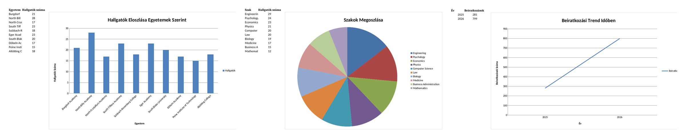

# University Data Management System (Python + Oracle)

A Python application that covers the full data lifecycle for a university domain
model (universities, students, courses, enrolments): **generate → store → load into
a relational database → analyse**. Built as a university course project at the
University of Debrecen.



*Charts from the automatically generated Excel report: students per university,
programme popularity and enrolment trend.*

## What it does

- **Test data generation** with Faker, using an object-oriented model built on Python
  `dataclass`es.
- **Multi-format storage** – writes and reads back CSV, JSON and XLSX through reusable
  handler classes.
- **Relational database** – creates an Oracle schema with primary and foreign keys,
  `ON DELETE CASCADE` and `UNIQUE` constraints, and loads the data with cx_Oracle.
- **Analytics report** – generates an Excel workbook with bar, pie and line charts
  (student distribution, programme popularity, GPA analysis with colour scales,
  enrolment trends).

## Tech stack

Python 3.10+ · [Faker](https://faker.readthedocs.io/) ·
[openpyxl](https://openpyxl.readthedocs.io/) ·
[cx_Oracle](https://oracle.github.io/python-cx_Oracle/) ·
[python-dotenv](https://pypi.org/project/python-dotenv/) · Oracle SQL

## Project structure

```
data/
├── app.py                      # Entry point – runs the whole pipeline
├── basics/
│   ├── model_dataclasses.py    # Data models (University, Student, Course, Enrollment)
│   ├── handler.py              # CSV / JSON / XLSX handlers
│   └── handler/
│       └── oracle_handler.py   # Oracle connection, schema and inserts
└── extra/
    └── analytics.py            # Analytics report with charts
```

## Getting started

```bash
pip install -r requirements.txt
python data/app.py
```

Everything except the Oracle step runs without a database. To enable the Oracle step,
copy `.env.example` to `.env` and fill in your own connection details:

```
ORACLE_USER=your_username
ORACLE_PASSWORD=your_password
ORACLE_DSN=host:1521/service_name
# ORACLE_CLIENT_LIB_DIR=C:\path\to\instantclient   (only if Instant Client is not on PATH)
```

`.env` is listed in `.gitignore`, so credentials never end up in the repository.

## Output

```
output/
├── csv/                    # universities, students, courses, enrollments
├── json/                   # the same data as JSON
├── xlsx/data.xlsx          # one worksheet per table
└── analytics_report.xlsx   # report with charts
```

---

## Magyarul röviden

Egyetemi kurzusprojekt (Debreceni Egyetem): Python-alkalmazás, amely egyetemi
adatokat (egyetemek, hallgatók, kurzusok, beiratkozások) generál, CSV/JSON/XLSX
formátumban tárol és olvas vissza, Oracle-adatbázisba tölt (elsődleges és külső
kulcsokkal, megszorításokkal), végül diagramos Excel-elemzést készít.
Futtatás: `pip install -r requirements.txt`, majd `python data/app.py`. Az Oracle-lépéshez
a `.env.example` alapján hozz létre egy `.env` fájlt a saját adataiddal.
